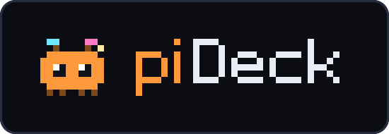
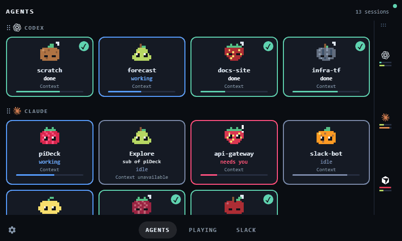
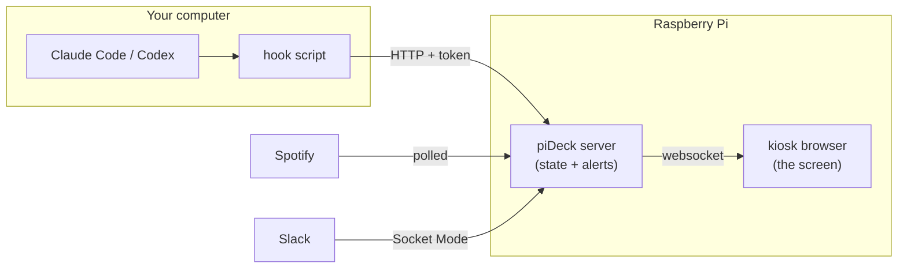

<h1 align="center">
  
</h1>

<p align="center"><b>A desk display for Raspberry Pi, Windows, and macOS:</b> Claude Code, Codex, and Cursor agent status, Spotify now-playing, and Slack notifications in one app. Swipe between pages; important events take over the whole screen.</p>

<p align="center">
  <a href="https://github.com/zapulam/piDeck/actions/workflows/ci.yml"></a>
  <a href="LICENSE"></a>
  
  
  
  
  
  
</p>

<p align="center">
  <br>
  <sub>Agents with a thin usage column, a completion celebration, detailed usage, then Spotify and Slack on an 800×480 display. All sessions, usage values, messages and album art are mock examples.</sub>
</p>

## How it works



- **On your computer:** nothing stays running. You run one install command once; after that Claude Code or Codex starts a small hook script (Python, standard library only) on each event, and it posts the event to the Pi and exits.
- **On the Pi:** the piDeck server and a full-screen browser. Spotify and Slack are connected from the Pi, so those credentials never touch your computer.

Every source just tells the hub "state changed" or "raise an alert"; the UI is a single static page (no build step, works offline). Adding a new page = one source module + one renderer in `pideck/ui/app.js`.

## Try it now (no accounts needed)

```bash
python3 -m venv .venv && . .venv/bin/activate
pip install -r requirements.txt
python -m pideck --mock          # open http://localhost:8765  (use arrow keys or swipe)
```

## Integrations

- **Claude Code** — one tile per session: working, needs you, done, idle, with a context-used bar and full-screen alerts. Tiny account bars show reported 5-hour and weekly allowance usage. Connects through Claude Code hooks and its status line. [Setup](#claude-code-and-codex)
- **Codex CLI** — the same tiles, context bars, and account usage bars. Reads usage from local session logs through Codex hooks, or the older `notify` setting (done-only). [Setup](#claude-code-and-codex)
- **Cursor** — session tiles, working/done/error states, and context snapshots before compaction through Cursor hooks. API and Included allowance bars use the sign-in already on this computer. [Setup](#cursor)
- **Spotify** — now playing with album art and progress, plus play/pause/next/previous (controls need Premium). Connects through the Spotify Web API. [Setup](#spotify)
- **Slack** — DMs and @mentions to your bot, plus any channels you pick, with alerts. Connects through Socket Mode, so no public URL is needed. [Setup](#slack)

Each one can be switched off under `modules:` in `config.yaml`, and the pages you see are listed under `views:`. Spotify, Slack and Codex are covered by automated tests with simulated data; they haven't been run against live accounts yet, so expect to tune a little on first use. Want another source? A new integration is one module in `pideck/sources/` plus one page renderer in `pideck/ui/app.js`.

## Setup

### Desktop installers

Download the Windows setup executable or the macOS disk image produced by the **Desktop installers** workflow. These bundles include Python and dependencies. Windows setup creates a Start menu shortcut, offers a desktop shortcut and start-at-login option, and installs Microsoft WebView2 if it is missing (that prerequisite needs internet access). On macOS, drag piDeck to Applications; choose the Intel or Apple Silicon image matching your Mac.

The initial packages are **unsigned test builds**. Windows may display an unknown-publisher warning; macOS may require an explicit Open Anyway exception. They are not publisher-verified distributions. Signing and Apple notarization are supported when external certificates are available.

Open Settings with the gear button to connect installed agents, connect Spotify, open configuration, or enable startup. Configuration is separate from application files: `%LOCALAPPDATA%\piDeck` on Windows and `~/Library/Application Support/piDeck` on macOS. Copy `.env.example` to `.env` there and add account settings. Packaged apps import credentials into Windows Credential Manager or macOS Keychain and remove imported secrets from `.env`. Restart after editing integration settings. Upgrades preserve the configuration folder; Windows uninstall preserves it too. On Mac, disable startup before moving the app to Trash.

### Desktop from source: Windows and macOS

Clone this repository, then run the setup script for your computer (Python 3.11+ required):

**Windows** (PowerShell, from the repo root):

```powershell
powershell -ExecutionPolicy Bypass -File scripts\setup-windows.ps1
.\run-desktop.cmd
```

**macOS:**

```bash
bash scripts/setup-macos.sh
./run-desktop
```

Each script creates `.venv`, installs desktop dependencies, writes a `run-desktop` launcher, and installs Claude Code / Codex / Cursor hooks aimed at `http://localhost:8765` (with a separate event-only credential). The launcher always passes the repo `config.yaml`, so the `.env` beside it is the one Spotify, Slack, and the local server use. `python -m pideck.desktop` does the same when you start it from the repo. Pass `-NoHooks` / `--no-hooks` to skip hooks, or `--url` / `--token` when the display is a remote Pi.

The same script puts piDeck in the Windows Start menu, and on macOS it writes `~/Applications/piDeck.app` so Launchpad and Spotlight can open it. Both still run this clone and its `.venv`. Re-run the script after moving the folder.

To open piDeck when you log in, run the setup script again with `-Startup` on Windows or `--startup` on macOS. Windows adds a Startup-folder shortcut. macOS adds a login LaunchAgent. Remove that shortcut or plist to stop it.

The resizable window starts at 520×720. `--on-top` keeps it above other windows; `--mock` shows demo data. Closing the window stops its local server. Prefer the browser instead? Run `.venv`'s `python -m pideck --mock` and open `http://localhost:8765`.

Logs and the persistent browser profile still live under `%LOCALAPPDATA%/piDeck` on Windows and `~/Library/Application Support/piDeck` on macOS. Use `--port` to choose another local port and point the hooks at that port as well.

To view an existing Pi server instead, use `python -m pideck.desktop --url "https://YOUR-PI-HTTPS-ADDRESS/"`, then enter its display token. Remote plain HTTP and URL query tokens are refused. Credentials become expiring HttpOnly cookies plus an origin-bound session proof; they are not kept in local storage. The owned native window signs in automatically from its private local credentials. A second launch activates the existing owned window.

Windows uses the [WebView2 Runtime](https://developer.microsoft.com/microsoft-edge/webview2/) (usually already installed with Edge); macOS uses WebKit. If Windows reports that WebView2 is missing, install Microsoft's Evergreen runtime.

The Windows desktop window uses piDeck's raspberry icon in the taskbar. After updating an older installation, rerun `scripts/setup-windows.ps1` to update desktop dependencies, then restart piDeck. If an existing pinned Python shortcut keeps its old icon, unpin it and pin the piDeck Start menu shortcut instead.

### 1. On the Raspberry Pi: the server and the screen

```bash
git clone https://github.com/zapulam/piDeck ~/piDeck && cd ~/piDeck
sudo sh deploy/install-pi.sh
```

The installer creates a non-login `pideck` system account automatically. Application files and the bundled virtual environment live under `/opt/pideck`, owned by root. Private configuration and writable data live under `/var/lib/pideck`, owned by the service account. The service starts at boot and listens only on `127.0.0.1:8765`. Use `sudo` to edit `/var/lib/pideck/config.yaml` and `.env`; do not make those files publicly readable. Existing installs should copy their configuration and credentials into this directory with owner `pideck` and mode `600` before restarting the service.

For another computer to connect, use HTTPS. For example, Tailscale Serve can forward an HTTPS address to `http://127.0.0.1:8765`. Configure `server.trusted_proxy_ips: [127.0.0.1]` only when that trusted local proxy supplies the original client address and HTTPS scheme; preserve the public Host header. Wildcard proxy trust is not accepted. Direct network listeners instead require `--tls-cert` and `--tls-key`. Do not forward the raw HTTP port through a router.

The service creates two credentials in its private `.env`: `PIDECK_TOKEN` signs a display in; `PIDECK_HOOK_TOKEN` only submits agent events. Enter the display token when opening the local kiosk or remote HTTPS page. The kiosk is no longer implicitly trusted simply because it runs on the Pi. `deploy/kiosk.sh` opens the local page from the graphical user's autostart; it never requires access to the service's private files. A continuously open authenticated display renews its private session, but a service restart requires signing in again.

For Spotify and Slack, add credentials to the service's private `.env` and restart it. The headless service does not inspect the graphical user's agent transcripts or provider sign-ins; hooks on the agent's computer send the permitted event data.

**Portrait, landscape, or rotated.** The layout follows the screen's shape on its own: portrait (720×1280), landscape (1280×720, 800×480), and square all work. The Raspberry Pi Touch Display 2 is natively portrait, so to use it sideways either rotate it in the OS (recommended: Screen Configuration on Raspberry Pi OS, or `wlr-randr --output DSI-1 --transform 90`; touch rotates with it), or set `ui.rotate: 90` (or 180 / 270) in `config.yaml`. Try it live with `http://localhost:8765/?rotate=90`.

### Claude Code and Codex

On each computer that runs Claude Code or Codex you need Python 3 and a copy of this repo (or just its `hooks/` folder). Run once:

```bash
python3 hooks/install.py --url https://YOUR-PI-HTTPS-ADDRESS --token YOUR_PIDECK_HOOK_TOKEN --test
```

It checks the server is reachable, saves the address and token, copies the hook script next to them (so the repo can be deleted afterwards), adds the hooks to Claude Code and/or Codex (whichever it finds), and shows a test tile on the display. For Claude, it also wraps the status-line command to forward usage data, preserving the existing command's input, output, and settings; uninstall restores it. It keeps a backup of anything it edits and can be re-run safely. `--dry-run` shows what it would do; `--uninstall` removes everything. Restart any open sessions afterwards. **If you already installed the hooks, rerun this command to pick up usage reporting.**

It works the same for the terminal and for desktop or editor apps, because the address is saved in a file rather than an environment variable (apps launched from a dock or Start menu don't see shell exports).

<details>
<summary>Prefer to do it by hand?</summary>

Merge `hooks/settings.example.json` into `~/.claude/settings.json` (and `hooks/codex-hooks.example.json` into `~/.codex/hooks.json`), fixing the script path, and put your address in `~/.config/pideck/hook.json` as `{"url": "https://YOUR-PI-HTTPS-ADDRESS", "token": "..."}`, or export `PIDECK_URL` and `PIDECK_HOOK_TOKEN`.
</details>

**What the tiles show.** Each session becomes a tile with its own pixel fruit, picked from the project name (piDeck is always the raspberry). **Working**: a blue outline, bouncing fruit, and a three-dot thought bubble at random intervals. **Needs you**: a blinking "!" and a full-screen alert. **Done**: a brief full-screen celebration with a randomly chosen cowboy hat, graduation cap, baseball cap, or sunglasses, then an asleep fruit with a completion checkmark on its tile. Click the tile (or focus it and press Enter or Space) to mark it as seen; resuming work also clears the checkmark. Acknowledgments survive display reloads. Hooks do not report when you merely focus a session in another app. **Idle**: awake, blinking and glancing around at random intervals. **Error**: dull colours and a sweat drop. Each tile labels its provider and context-used percentage and bar when available.

Notes: the tile name is the project folder (override with `PIDECK_NAME`). Context % is estimated from the session transcript's latest token usage against `PIDECK_CONTEXT_WINDOW` (default 200000; set 1000000 for 1M-context models). It's an estimate, not an official number. Drop `PostToolUse` from the hooks if you don't want a process spawned per tool call; the only downside is a tile staying "needs you" until the next prompt or stop.

**Arrange your display.** Drag a provider heading to move its entire group up or down. The headings also support the up/down arrow keys. Account usage defaults to a thin column on the right. Drag its small grip to dock it at another edge; drop targets show the selected position. The grip also accepts arrow keys, and Settings provides position buttons and a layout reset. Group order and docking are remembered on this display across reloads, and live updates preserve them.

**Account usage.** Two tiny bars sit beneath each provider logo, with no numerical labels in the compact column. The first bar is the short window and the second is weekly; Cursor shows API first and Included second. Each bar has one solid color that changes smoothly from green through yellow toward red as usage fills up, reaching red at 100%. These are account totals shared across sessions. Click the **AGENTS** heading or a provider logo to open detailed usage with percentages and reset times. Sessions collapse into a sprite column on the left; click a sprite to return to that session card, or click **USAGE** to return to the full agents view. The session count stays visible in both views. Zero is distinct from unavailable data in the detailed view; missing, expired, or stale values stay unavailable instead of implying zero usage.

Updates arrive with agent activity. Opening the display also refreshes the Claude and Cursor totals from the sign-in already on this computer and posts only the percentages. Old metrics become unavailable after `stale_hours`. If several computers report the same provider, the most recently received report is shown; use the same account on those computers for consistent totals. Provider logos are bundled locally, with attribution in [the logo notice](pideck/ui/logos/NOTICE.md).

**Settings.** The gear stays in the bottom-left and opens its own Settings page. It always stays accessible, even when you turn off Agents, Playing, and Slack. Page navigation stays along the bottom in portrait and landscape.

Claude's 5-hour and weekly values come from the sign-in already on this computer when that sign-in includes an access token, and from the documented [status-line payload](https://code.claude.com/docs/en/statusline) after Claude reports them. The status line also supplies the model's context percentage. The access token is not sent to the display. A fresh sample is kept so the next launch can show the bars before Claude sends another status line. An empty saved sign-in leaves the allowance values to the status line.

**Codex specifics.** Codex has lifecycle hooks with the same shape as Claude Code's, so the same script works (the installer passes `--source codex`).

1. Codex hooks may be behind a feature flag on your version. If nothing shows up, add this to `~/.codex/config.toml`:
   ```toml
   [features]
   codex_hooks = true
   ```
2. No hooks? The older `notify` setting also works: `notify = ["python3", "/path/to/piDeck/hooks/pideck_hook.py"]` in `~/.codex/config.toml`. It only reports "turn finished", so you get done tiles and alerts but no working or needs-you states.

Codex context and allowance usage come from recent local `token_count` records: the last request's token usage divided by the reported context-window size, plus the `codex` account rate-limit bucket. The hook uses `transcript_path` when supplied, or finds the matching session ID under `$CODEX_HOME/sessions` (default `~/.codex/sessions`), including in notify mode. It reads only the last 256 KiB, and sends only the resulting percentages and reset times. These local logs can vary by Codex version; missing metrics stay unavailable. The account-window meanings match the [official OpenAI documentation](https://developers.openai.com/codex/app-server#auth-endpoints).

Differences from Claude Code: Codex has no session-end event, so a finished tile stays until it goes stale (`stale_hours`) or you clear it; the needs-you state only appears if your Codex version emits a `PermissionRequest` hook event. Lifecycle integration still needs checking against your installed Codex version.

### Cursor

The hook installer auto-detects `~/.cursor`, or you can select it explicitly:

```bash
python hooks/install.py --cursor --url https://YOUR-PI-HTTPS-ADDRESS --token YOUR_PIDECK_HOOK_TOKEN
```

It merges piDeck's flat hook entries into `~/.cursor/hooks.json`, preserves other hooks and settings, and backs up the original file. Reinstalling is safe; `--dry-run` changes nothing and `--uninstall` removes only piDeck entries. Restart Cursor after installation. See [Cursor's hook documentation](https://cursor.com/docs/hooks) for version and environment support.

Conversation IDs produce one tile across turns. Prompt submission and tool completion report working; `stop` reports done, cancelled, or error; session end removes the tile. A denied tool reports needs-you, although hooks do not provide a general signal for every approval prompt. piDeck does not block actions or send follow-up prompts, and it does not forward your prompts, email address, or tool inputs.

Cursor exposes `context_usage_percent` on `preCompact`, rather than a continuous context feed. piDeck labels that bar **Before compact** and clears it on the next lifecycle update so the pre-compaction snapshot is not mistaken for current usage. Account bars use Cursor's own usage service: piDeck reads the sign-in already stored in Cursor's local database, refreshes it when it has expired, and posts only the Included and API percents. The access token is not sent to the display. If that sign-in cannot be read or Cursor requires a new sign-in, the values stay unavailable.

When the display starts, and again every 15 minutes, it reads Claude, Codex, and Cursor session files touched in the last six hours and shows those chats even if they began before piDeck was open. A file touched in the last two minutes is shown as working; an older one is idle. Claude's account values are remembered from the last status-line report, because Claude does not write those percents into the session file. Codex's account values are read from the newest local session log. Re-run the hook installer so subagent events are registered.

A Claude or Cursor subagent gets its own tile, named for its agent type and tagged `sub of` the parent project. The task text and the subagent's reply are not sent. Codex does not currently emit a subagent hook piDeck can subscribe to.

### Spotify

1. Create an app at <https://developer.spotify.com/dashboard>, add redirect URI `http://127.0.0.1:8888/callback`.
2. Put `SPOTIFY_CLIENT_ID` in the private `.env`. Connect Spotify from desktop Settings, or run `python -m pideck.spotify_auth --config /path/to/config.yaml` for source/Pi setup. PKCE validates the setup attempt and saves the refresh token privately; no shipped client secret is needed. Existing secret-based authorizations can retain `SPOTIFY_CLIENT_SECRET`.
3. Now-playing works on any account; the on-screen play/pause/next/previous buttons need **Premium**.

### Slack

Create an app at <https://api.slack.com/apps> and:
- turn on **Socket Mode**, create an app-level token with `connections:write` → `SLACK_APP_TOKEN` (`xapp-…`)
- bot scopes: `users:read`, `im:history`, `app_mentions:read`, `channels:read` (+ `channels:history` for watched channels)
- event subscriptions (bot): `message.im`, `app_mention` (+ `message.channels`)
- install to your workspace → `SLACK_BOT_TOKEN` (`xoxb-…`)

You get DMs to the bot and @mentions of it in channels it's invited to. To watch extra channels, list their IDs under `modules.slack.channels`. Your own DMs with other people are not visible to a bot app. (Your workspace may require admin approval to install the app.)

## Development

```bash
pip install -r requirements-dev.txt
pytest -m "not browser"
python -m playwright install chromium
pytest -m browser
python scripts/check_python_style.py
```

CI runs tests on Linux, Windows, and Intel macOS with Python 3.11 and 3.13; Chromium tests check the real websocket UI at four window sizes. macOS 26 uses the Intel runner pool because GitHub's ARM pool has been cancelling jobs before any test starts. It also checks Python/JavaScript syntax, Python documentation and formatting conventions, workflow validity, commit attribution, and dependency vulnerabilities. The stable required check is **CI passed**, which succeeds only after every validation job passes.

Python files start with a descriptive module docstring surrounded by blank lines inside the quotes, use `# --- Group ---` section comments, and end with exactly one LF newline. Function parameters and their closing parenthesis use one additional four-space indentation level on separate lines. Functions have type annotations and full docstrings describing their behavior, typed arguments, and typed returns, including `None`. See [AGENTS.md](AGENTS.md) for the complete conventions; the style checker, EditorConfig, and Git attributes keep them consistent across platforms.

Regenerate the README walkthrough from isolated mock data with `pip install Pillow` and `python scripts/record_demo.py` after installing the development dependencies and Playwright Chromium above. The recorder uses the real UI and does not read account credentials or session transcripts.

All workflow actions are pinned to reviewed commit SHAs. PR workflows have read-only repository access; only the release publication job receives release and attestation permissions. Dependencies are updated manually, with a weekly vulnerability audit and audits on every PR. Version-update PRs from Dependabot are disabled to avoid adding bot-authored commits. AI-assisted contributions and Claude, Codex, and Cursor credit trailers are welcome. The attribution gate requires human authors and committers and rejects Dependabot and other bot credit trailers; human and AI tool credits remain allowed.

## Releases

The version in `pideck/__init__.py` is the source of truth. After merging a tested version change, create a matching tag such as `v0.1.0` on `main` and push it. The **Release** workflow validates the tag/version and main-branch ancestry, reruns CI against that exact commit, and creates a draft GitHub Release only after every check succeeds. Pre-release tags such as `v0.2.0-rc.1` must match the version string and are marked as pre-releases.

Each release includes a source ZIP (for cloning alternatives, Pi installs, and archival) and `SHA256SUMS`. GitHub build-provenance attestations are generated where the repository supports them; GitHub does not support stored attestations for user-owned private repositories, so those releases disclose their absence in the notes and workflow summary. Desktop installers are built natively after security checks and include dependency audit results, build provenance, and checksums. Unsigned files are explicitly labeled; checksums do not establish publisher identity. You can check downloads with `sha256sum --check SHA256SUMS` and, when an attestation is available, verify provenance with `gh attestation verify <archive.zip> --repo zapulam/piDeck`.

Tag pushes keep releases as drafts for review. Publish a completed draft in GitHub's Releases UI, or manually run **Release** with the existing tag and **Keep the release as a draft** disabled. Publication creates a draft first, uploads assets, and then publishes only when requested; an interrupted draft can be retried. A draft build still runs the full CI pipeline. Release notes come from `docs/releases/<tag>.md` when present.

Refreshing an already published release requires an explicit manual **Release** run with **Replace assets of an existing published release** enabled. This reruns CI on the exact tagged commit before replacing the source archive, checksums, and notes and producing fresh attestations where supported. Retargeting a published tag requires explicit authorization; the workflow never moves tags itself.

When accepting dependency or AI-assisted updates on Zachary's behalf, keep `Zachary <84103628+zapulam@users.noreply.github.com>` as author and committer and include the assisting tool's own `Co-authored-by` trailer. Preserve human and AI tool credits in pull requests and squash commits, while removing Dependabot and other bot credits. Squash merges default to commit messages; review the merge message to retain tool credit trailers. Repository guidance documents this policy; Claude Code uses its default attribution because the project no longer overrides it. Tool credit trailers can add the credited tools to GitHub's contributor display.

## Security

The server binds to loopback by default. Every real display, including the local kiosk, authenticates. Hook credentials are event-only and cannot read Slack, open browser sessions, or control playback. Remote connections require HTTPS; authenticated HTTP requests never follow redirects. Browser sessions use HttpOnly same-site cookies and a session proof confined to the page origin, with renewal, expiration, and explicit disconnect.

Message text, including Claude notifications, stays private unless `PIDECK_SEND_MESSAGES=1` or `"send_messages": true` is enabled. Only project folder names are sent by default; full paths require `PIDECK_SEND_PATHS=1`. Provider access credentials stay on the agent computer and only reduced usage fields reach the display.

Requests have raw-body, rate, session, and client limits. Slow displays time out independently. Logs redact legacy query credentials and native bootstrap fragments. Packaged secrets use the OS vault; source/Pi secrets and hook settings use private files with Unix owner permissions or Windows ACLs.

**Upgrade migration:** the first secured startup rotates the old display credential because previous versions also gave it to hooks and could log it. Reconnect displays and reinstall hooks with the new `PIDECK_HOOK_TOKEN`, or use desktop Settings → Connect installed agents. Existing query-token links and non-local HTTP hook URLs must be replaced.

The Pi service runs as a dedicated account with read-only application files and private writable state. Desktop builds use hash-locked dependencies and are tested on native Windows, Intel Mac, and Apple Silicon runners. See [SECURITY.md](SECURITY.md) for the threat model and reporting process.
