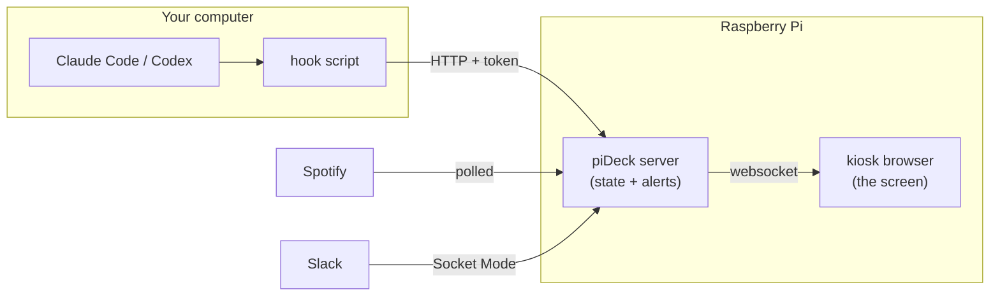

<h1 align="center">
  
</h1>

<p align="center"><b>A desk display for Raspberry Pi, Windows, and macOS:</b> Claude Code, Codex, and Cursor agent status, Spotify now-playing, and Slack notifications in one app. Swipe between pages; important events take over the whole screen.</p>

<p align="center">
  <a href="https://github.com/zapulam/piDeck/actions/workflows/ci.yml"></a>
  <a href="LICENSE"></a>
  
  
  
  
  
  
</p>

<p align="center">
  <br>
  <sub>A walkthrough of the Agents, Playing and Slack pages on an 800×480 display running <code>--mock</code> data. Album art is the property of its owners and is shown for illustration only.</sub>
</p>

## How it works



- **On your computer:** nothing stays running. You run one install command once; after that Claude Code or Codex starts a small hook script (Python, standard library only) on each event, and it posts the event to the Pi and exits.
- **On the Pi:** the piDeck server and a full-screen browser. Spotify and Slack are connected from the Pi, so those credentials never touch your computer.

Every source just tells the hub "state changed" or "raise an alert"; the UI is a single static page (no build step, works offline). Adding a new page = one source module + one renderer in `pideck/ui/app.js`.

## Try it now (no accounts needed)

```bash
python3 -m venv .venv && . .venv/bin/activate
pip install -r requirements.txt
python -m pideck --mock          # open http://localhost:8765  (use arrow keys or swipe)
```

## Integrations

- **Claude Code** — one tile per session: working, needs you, done, idle, with a context-used bar and full-screen alerts. Account cards show reported 5-hour and weekly allowance usage. Connects through Claude Code hooks and its status line. [Setup](#claude-code-and-codex)
- **Codex CLI** — the same tiles, context bars, and account usage cards. Reads usage from local session logs through Codex hooks, or the older `notify` setting (done-only). [Setup](#claude-code-and-codex)
- **Cursor** — session tiles, working/done/error states, and context snapshots before compaction through Cursor hooks. Account allowances are unavailable through the hook interface. [Setup](#cursor)
- **Spotify** — now playing with album art and progress, plus play/pause/next/previous (controls need Premium). Connects through the Spotify Web API. [Setup](#spotify)
- **Slack** — DMs and @mentions to your bot, plus any channels you pick, with alerts. Connects through Socket Mode, so no public URL is needed. [Setup](#slack)

Each one can be switched off under `modules:` in `config.yaml`, and the pages you see are listed under `views:`. Spotify, Slack and Codex are covered by automated tests with simulated data; they haven't been run against live accounts yet, so expect to tune a little on first use. Want another source? A new integration is one module in `pideck/sources/` plus one page renderer in `pideck/ui/app.js`.

## Setup

### Desktop: Windows and macOS

Clone this repository, then run the setup script for your computer (Python 3.11+ required):

**Windows** (PowerShell, from the repo root):

```powershell
powershell -ExecutionPolicy Bypass -File scripts\setup-windows.ps1
.\run-desktop.cmd
```

**macOS:**

```bash
bash scripts/setup-macos.sh
./run-desktop
```

Each script creates `.venv`, installs desktop dependencies, writes a `run-desktop` launcher, and installs Claude Code / Codex / Cursor hooks aimed at `http://localhost:8765` (no token needed for that local server). The launcher always passes the repo `config.yaml`, so the `.env` beside it is the one Spotify, Slack, and the local server use. `python -m pideck.desktop` does the same when you start it from the repo. Pass `-NoHooks` / `--no-hooks` to skip hooks, or `--url` / `--token` when the display is a remote Pi.

The same script puts piDeck in the Windows Start menu, and on macOS it writes `~/Applications/piDeck.app` so Launchpad and Spotlight can open it. Both still run this clone and its `.venv`. Re-run the script after moving the folder.

To open piDeck when you log in, run the setup script again with `-Startup` on Windows or `--startup` on macOS. Windows adds a Startup-folder shortcut. macOS adds a login LaunchAgent. Remove that shortcut or plist to stop it.

The resizable window starts at 520×720. `--on-top` keeps it above other windows; `--mock` shows demo data. Closing the window stops its local server. Prefer the browser instead? Run `.venv`'s `python -m pideck --mock` and open `http://localhost:8765`.

Logs and the persistent browser profile still live under `%LOCALAPPDATA%/piDeck` on Windows and `~/Library/Application Support/piDeck` on macOS. Use `--port` to choose another local port and point the hooks at that port as well.

To view an existing Pi server instead, use `python -m pideck.desktop --url "http://YOUR-PI:8765/?token=YOUR_PIDECK_TOKEN"`. This starts only a window; the Pi continues to run the server. The token is remembered in the desktop profile. If another local server already occupies the configured port, close it or use `--url http://localhost:8765` to view it.

Windows uses the [WebView2 Runtime](https://developer.microsoft.com/microsoft-edge/webview2/) (usually already installed with Edge); macOS uses WebKit. If Windows reports that WebView2 is missing, install Microsoft's Evergreen runtime.

### 1. On the Raspberry Pi: the server and the screen

```bash
git clone https://github.com/zapulam/piDeck ~/piDeck && cd ~/piDeck
python3 -m venv .venv && .venv/bin/pip install -r requirements.txt
sudo cp deploy/pideck.service /etc/systemd/system/ && sudo systemctl enable --now pideck
```

Edit `User=` and the paths in the service file if yours differ. Then start `deploy/kiosk.sh` from your desktop session's autostart (on Raspberry Pi OS with labwc: add `/home/pi/piDeck/deploy/kiosk.sh` to `~/.config/labwc/autostart`). The kiosk must open `http://localhost:8765`: the Pi's own browser is trusted without a token only on that address.

On first start the server creates an access token, saves it as `PIDECK_TOKEN` in `.env`, and prints the exact command to run on your computer. Run `python -m pideck` once in a terminal to see it, or find the token in `.env`.

For Spotify and Slack, copy the credentials from `.env.example` into `.env` (see their sections below) and set `mock: false` in `config.yaml`.

**Portrait, landscape, or rotated.** The layout follows the screen's shape on its own: portrait (720×1280), landscape (1280×720, 800×480), and square all work. The Raspberry Pi Touch Display 2 is natively portrait, so to use it sideways either rotate it in the OS (recommended: Screen Configuration on Raspberry Pi OS, or `wlr-randr --output DSI-1 --transform 90`; touch rotates with it), or set `ui.rotate: 90` (or 180 / 270) in `config.yaml`. Try it live with `http://localhost:8765/?rotate=90`.

### Claude Code and Codex

On each computer that runs Claude Code or Codex you need Python 3 and a copy of this repo (or just its `hooks/` folder). Run once:

```bash
python3 hooks/install.py --url http://YOUR-PI:8765 --token YOUR_PIDECK_TOKEN --test
```

It checks the server is reachable, saves the address and token, copies the hook script next to them (so the repo can be deleted afterwards), adds the hooks to Claude Code and/or Codex (whichever it finds), and shows a test tile on the display. For Claude, it also wraps the status-line command to forward usage data, preserving the existing command's input, output, and settings; uninstall restores it. It keeps a backup of anything it edits and can be re-run safely. `--dry-run` shows what it would do; `--uninstall` removes everything. Restart any open sessions afterwards. **If you already installed the hooks, rerun this command to pick up usage reporting.**

It works the same for the terminal and for desktop or editor apps, because the address is saved in a file rather than an environment variable (apps launched from a dock or Start menu don't see shell exports).

<details>
<summary>Prefer to do it by hand?</summary>

Merge `hooks/settings.example.json` into `~/.claude/settings.json` (and `hooks/codex-hooks.example.json` into `~/.codex/hooks.json`), fixing the script path, and put your address in `~/.config/pideck/hook.json` as `{"url": "http://YOUR-PI:8765", "token": "..."}`, or export `PIDECK_URL` and `PIDECK_TOKEN`.
</details>

**What the tiles show.** Each session becomes a tile with its own pixel fruit, picked from the project name (piDeck is always the raspberry). **Working**: a shine sweeps across it. **Needs you**: a blinking "!" and a full-screen alert. **Done**: asleep, plus an alert. **Idle**: awake, glancing around. **Error**: dull colours and a sweat drop. Each tile labels its provider and context-used percentage and bar when available.

Notes: the tile name is the project folder (override with `PIDECK_NAME`). Context % is estimated from the session transcript's latest token usage against `PIDECK_CONTEXT_WINDOW` (default 200000; set 1000000 for 1M-context models). It's an estimate, not an official number. Drop `PostToolUse` from the hooks if you don't want a process spawned per tool call; the only downside is a tile staying "needs you" until the next prompt or stop.

**Account usage.** Cards above the tiles show each connected provider's reported allowance usage, with separate short-window and weekly bars, reset countdowns, and the last update time. These are account totals, shared across sessions, rather than per-project totals. Zero usage is shown as 0%; missing data is marked unavailable, and expired windows await a fresh report. Updates arrive with agent activity, rather than through background account polling. Old cards disappear after `stale_hours` unless a session tile still exists; old metrics then display as unavailable. If several computers report the same provider, the most recently received report is shown; use the same account on those computers for consistent totals.

Claude account usage comes from the documented [status-line payload](https://code.claude.com/docs/en/statusline), when the signed-in plan and Claude version expose `rate_limits`. The status line also supplies the model's context percentage. The installer connects this automatically; manual lifecycle hooks alone supply the older context estimate but no account limits. No provider credentials or full transcripts are sent to piDeck.

**Codex specifics.** Codex has lifecycle hooks with the same shape as Claude Code's, so the same script works (the installer passes `--source codex`).

1. Codex hooks may be behind a feature flag on your version. If nothing shows up, add this to `~/.codex/config.toml`:
   ```toml
   [features]
   codex_hooks = true
   ```
2. No hooks? The older `notify` setting also works: `notify = ["python3", "/path/to/piDeck/hooks/pideck_hook.py"]` in `~/.codex/config.toml`. It only reports "turn finished", so you get done tiles and alerts but no working or needs-you states.

Codex context and allowance usage come from recent local `token_count` records: the last request's token usage divided by the reported context-window size, plus the `codex` account rate-limit bucket. The hook uses `transcript_path` when supplied, or finds the matching session ID under `$CODEX_HOME/sessions` (default `~/.codex/sessions`), including in notify mode. It reads only the last 256 KiB, and sends only the resulting percentages and reset times. These local logs can vary by Codex version; missing metrics stay unavailable. The account-window meanings match the [official OpenAI documentation](https://developers.openai.com/codex/app-server#auth-endpoints).

Differences from Claude Code: Codex has no session-end event, so a finished tile stays until it goes stale (`stale_hours`) or you clear it; the needs-you state only appears if your Codex version emits a `PermissionRequest` hook event. Lifecycle integration still needs checking against your installed Codex version.

### Cursor

The hook installer auto-detects `~/.cursor`, or you can select it explicitly:

```bash
python hooks/install.py --cursor --url http://YOUR-PI:8765 --token YOUR_PIDECK_TOKEN
```

It merges piDeck's flat hook entries into `~/.cursor/hooks.json`, preserves other hooks and settings, and backs up the original file. Reinstalling is safe; `--dry-run` changes nothing and `--uninstall` removes only piDeck entries. Restart Cursor after installation. See [Cursor's hook documentation](https://cursor.com/docs/hooks) for version and environment support.

Conversation IDs produce one tile across turns. Prompt submission and tool completion report working; `stop` reports done, cancelled, or error; session end removes the tile. A denied tool reports needs-you, although hooks do not provide a general signal for every approval prompt. piDeck does not block actions or send follow-up prompts, and it does not forward your prompts, email address, or tool inputs.

Cursor exposes `context_usage_percent` on `preCompact`, rather than a continuous context feed. piDeck labels that bar **Before compact** and clears it on the next lifecycle update so the pre-compaction snapshot is not mistaken for current usage. Account bars come from Cursor's own usage service: piDeck reads the sign-in already stored in Cursor's local database and posts only the Included and API percents. The access token is not sent to the display. If that sign-in cannot be read, the card stays unavailable.

When the display starts, and again every 15 minutes, it reads Claude, Codex, and Cursor session files touched in the last six hours and shows those chats even if they began before piDeck was open. A file touched in the last two minutes is shown as working; an older one is idle. Claude's account bars are remembered from the last status-line report, because Claude does not write those percents into the session file. Codex bars are read from the newest local session log. Re-run the hook installer so subagent events are registered.

A Claude or Cursor subagent gets its own tile, named for its agent type and tagged `sub of` the parent project. The task text and the subagent's reply are not sent. Codex does not currently emit a subagent hook piDeck can subscribe to.

### Spotify

1. Create an app at <https://developer.spotify.com/dashboard>, add redirect URI `http://127.0.0.1:8888/callback`.
2. Put `SPOTIFY_CLIENT_ID` / `SPOTIFY_CLIENT_SECRET` in `.env`, run `python -m pideck.spotify_auth`, paste the printed `SPOTIFY_REFRESH_TOKEN` into `.env`.
3. Now-playing works on any account; the on-screen play/pause/next/previous buttons need **Premium**.

### Slack

Create an app at <https://api.slack.com/apps> and:
- turn on **Socket Mode**, create an app-level token with `connections:write` → `SLACK_APP_TOKEN` (`xapp-…`)
- bot scopes: `users:read`, `im:history`, `app_mentions:read`, `channels:read` (+ `channels:history` for watched channels)
- event subscriptions (bot): `message.im`, `app_mention` (+ `message.channels`)
- install to your workspace → `SLACK_BOT_TOKEN` (`xoxb-…`)

You get DMs to the bot and @mentions of it in channels it's invited to. To watch extra channels, list their IDs under `modules.slack.channels`. Your own DMs with other people are not visible to a bot app. (Your workspace may require admin approval to install the app.)

## Development

```bash
pip install -r requirements-dev.txt
pytest -m "not browser"
python -m playwright install chromium
pytest -m browser
```

CI runs tests on Linux, Windows, and macOS with Python 3.11 and 3.13; Chromium tests check the real websocket UI at four window sizes. It also checks Python/JavaScript syntax, workflow validity, commit attribution, and dependency vulnerabilities. The stable required check is **CI passed**, which succeeds only after every validation job passes.

All workflow actions are pinned to reviewed commit SHAs. PR workflows have read-only repository access; only the release publication job receives release and attestation permissions. Dependencies are updated manually, with a weekly vulnerability audit and audits on every PR. Version-update PRs from Dependabot are disabled to avoid adding bot-authored commits. AI-assisted contributions and Claude, Codex, and Cursor credit trailers are welcome. The attribution gate requires human authors and committers and rejects Dependabot and other bot credit trailers; human and AI tool credits remain allowed.

## Releases

The version in `pideck/__init__.py` is the source of truth. After merging a tested version change, create a matching tag such as `v0.1.0` on `main` and push it. The **Release** workflow validates the tag/version and main-branch ancestry, reruns CI against that exact commit, and creates a draft GitHub Release only after every check succeeds. Pre-release tags such as `v0.2.0-rc.1` must match the version string and are marked as pre-releases.

Each release includes a source ZIP (for cloning alternatives, Pi installs, and archival), `SHA256SUMS`, and GitHub build-provenance attestations. Desktop Windows/macOS installs use the setup scripts in this repository rather than platform binaries. You can check downloads with `sha256sum --check SHA256SUMS` and verify provenance with `gh attestation verify <archive.zip> --repo zapulam/piDeck`.

Tag pushes keep releases as drafts for review. Publish a completed draft in GitHub's Releases UI, or manually run **Release** with the existing tag and **Keep the release as a draft** disabled. Publication creates a draft first, uploads assets, and then publishes only when requested; an interrupted draft can be retried, but published releases are never overwritten. A draft build still runs the full CI pipeline.

When accepting dependency or AI-assisted updates on Zachary's behalf, keep `Zachary <84103628+zapulam@users.noreply.github.com>` as author and committer and include the assisting tool's own `Co-authored-by` trailer. Preserve human and AI tool credits in pull requests and squash commits, while removing Dependabot and other bot credits. Squash merges default to commit messages; review the merge message to retain tool credit trailers. Repository guidance documents this policy; Claude Code uses its default attribution because the project no longer overrides it. Tool credit trailers can add the credited tools to GitHub's contributor display.

## Security

piDeck shows private things (Slack messages, what you are listening to, project names), so it is closed by default:

- **Only the Pi itself is trusted without a token.** The kiosk browser on `http://localhost:8765` just works. Everything else (the websocket, agent events, Spotify and Slack controls) needs the access token, which is created on first start and kept in `.env` (owner-only). Another device's browser can open `http://YOUR-PI:8765/?token=...` once; the token is remembered in that browser and removed from the address bar.
- **Cross-site and rebinding protection.** Requests and websockets from another web origin are refused, and "this machine" must be reached as `localhost`, so a web page you visit can't read your display or press its buttons.
- **Limits.** Event fields have length caps, and at most 100 sessions and 16 screens are kept.
- **Your replies stay on your computer by default.** The hook sends project names, states and short system notifications, not what the assistant said. To also show a 200-character snippet of the last reply on "done" alerts, set `PIDECK_SEND_MESSAGES=1` or `"send_messages": true` in `~/.config/pideck/hook.json`.
- **Sandboxed service.** `deploy/pideck.service` drops privileges and restricts the filesystem and network families. CI and a scheduled weekly audit run `pip-audit`; dependency updates are maintained manually.

What it does not do: encrypt traffic. The hook talks plain HTTP, so on a network you don't trust, put the Pi and your computer on a private tunnel such as [Tailscale](https://tailscale.com) or WireGuard (or put an HTTPS reverse proxy in front), and use the tunnel address as `--url`. For local-only use, set `server.host: 127.0.0.1`. See [SECURITY.md](SECURITY.md) to report a problem.
