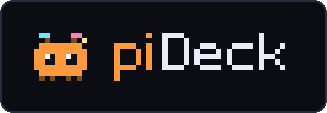
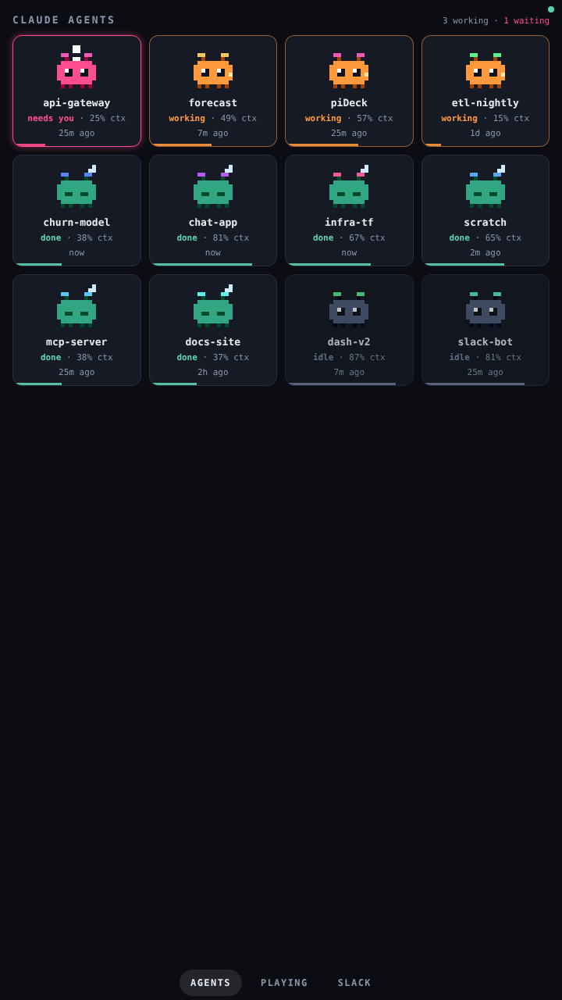
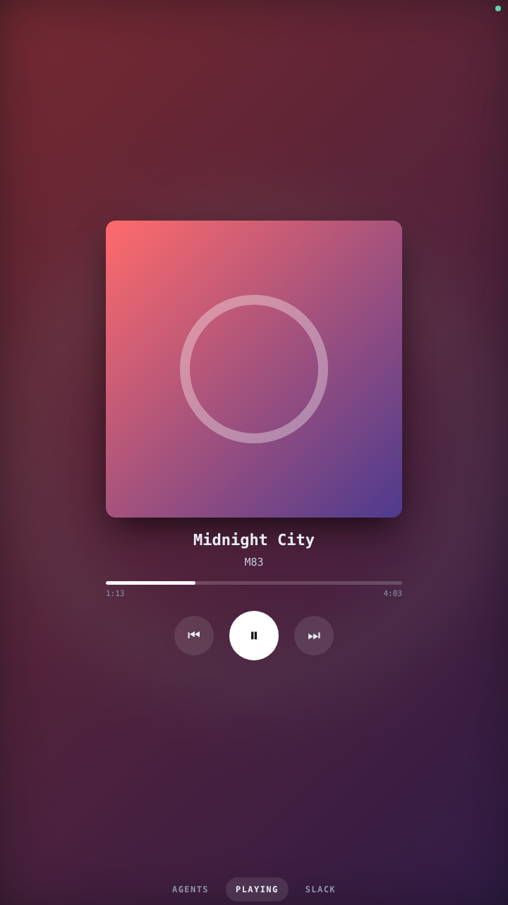

<h1 align="center">
  
</h1>

<p align="center"><b>A Raspberry Pi desk display:</b> Claude Code agent status, Spotify now-playing, and Slack notifications in one app. Swipe between pages; important events take over the whole screen.</p>

<p align="center">
  <a href="https://github.com/zapulam/piDeck/actions/workflows/ci.yml"></a>
  <a href="LICENSE"></a>
  
  
  
  
  
</p>

<p align="center">
   <br>
  <sub>screenshots use <code>--mock</code> data</sub>
</p>

## How it works

```
Claude Code hooks ──POST──┐
Spotify Web API ──poll────┼─▶ pideck server (FastAPI) ──websocket──▶ browser UI (kiosk on the Pi)
Slack Socket Mode ──push──┘        hub = state + alerts
```

Every source just tells the hub "state changed" or "raise an alert"; the UI is a single static page (no build step, works offline). Adding a new page = one source module + one renderer in `pideck/ui/app.js`.

## Try it now (no accounts needed)

```bash
python3 -m venv .venv && . .venv/bin/activate
pip install -r requirements.txt
python -m pideck --mock          # open http://localhost:8765  (use arrow keys or swipe)
```

## Setup

Copy `.env.example` to `.env` and `config.yaml` is already there; set `mock: false`.

### Claude agents
1. Optional but recommended: set `PIDECK_TOKEN` in `.env` (any random string).
2. On each machine that runs Claude Code, merge `hooks/settings.example.json` into `~/.claude/settings.json` (fix the script path), and export `PIDECK_URL` (e.g. `http://pideck.local:8765`) and `PIDECK_TOKEN`.
3. Each session becomes a tile: **working** (orange, bouncing), **needs you** (pink, pulses + full-screen alert), **done** (teal, sleeping + alert), **idle**. The bar along the bottom is context used.

Notes: the tile name is the project folder (override with `PIDECK_NAME`). Context % is estimated from the session transcript's latest token usage against `PIDECK_CONTEXT_WINDOW` (default 200000; set 1000000 for 1M-context models). It's an estimate, not an official number. Drop `PostToolUse` from the hooks if you don't want a process spawned per tool call; the only downside is a tile staying "needs you" until the next prompt or stop.

### Spotify
1. Create an app at <https://developer.spotify.com/dashboard>, add redirect URI `http://127.0.0.1:8888/callback`.
2. Put `SPOTIFY_CLIENT_ID` / `SPOTIFY_CLIENT_SECRET` in `.env`, run `python -m pideck.spotify_auth`, paste the printed `SPOTIFY_REFRESH_TOKEN` into `.env`.
3. Now-playing works on any account; the on-screen play/pause/next/previous buttons need **Premium**.

### Slack
Create an app at <https://api.slack.com/apps> and:
- turn on **Socket Mode**, create an app-level token with `connections:write` → `SLACK_APP_TOKEN` (`xapp-…`)
- bot scopes: `users:read`, `im:history`, `app_mentions:read`, `channels:read` (+ `channels:history` for watched channels)
- event subscriptions (bot): `message.im`, `app_mention` (+ `message.channels`)
- install to your workspace → `SLACK_BOT_TOKEN` (`xoxb-…`)

You get DMs to the bot and @mentions of it in channels it's invited to. To watch extra channels, list their IDs under `modules.slack.channels`. Your own DMs with other people are not visible to a bot app. (Your workspace may require admin approval to install the app.)

## On the Pi

```bash
git clone https://github.com/zapulam/piDeck ~/piDeck && cd ~/piDeck
python3 -m venv .venv && .venv/bin/pip install -r requirements.txt
sudo cp deploy/pideck.service /etc/systemd/system/ && sudo systemctl enable --now pideck
```
Then start `deploy/kiosk.sh` from your desktop session's autostart (on Raspberry Pi OS with labwc: add `/home/pi/piDeck/deploy/kiosk.sh` to `~/.config/labwc/autostart`). Edit `User=`/paths in the service file if yours differ.

Screens: layout is responsive (portrait 720×1280 and square both look right). Pages are listed in `views:` in `config.yaml`.

## Development

```bash
pip install -r requirements-dev.txt
pytest
```

## Security

The server has no login. Anything on your network can open the display and use the Spotify buttons; the agent endpoint is protected by `PIDECK_TOKEN` when set. Keep it on a trusted LAN, or set `server.host: 127.0.0.1` if you only use it locally.
