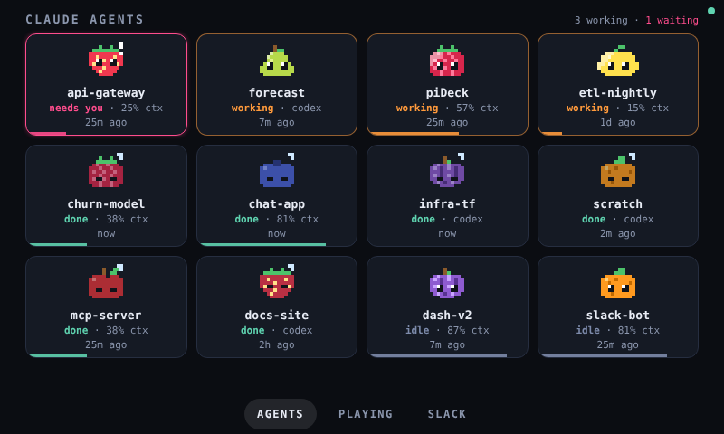
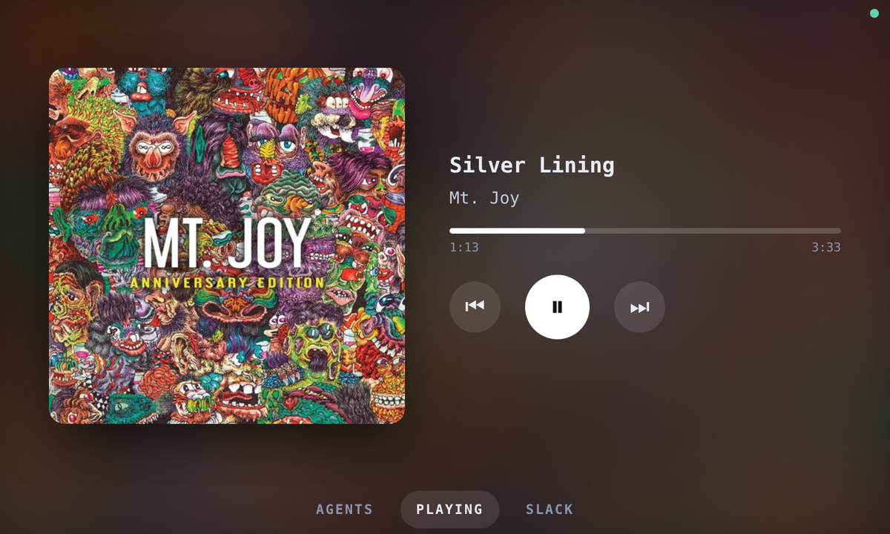
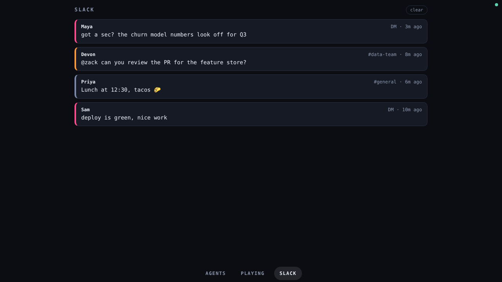
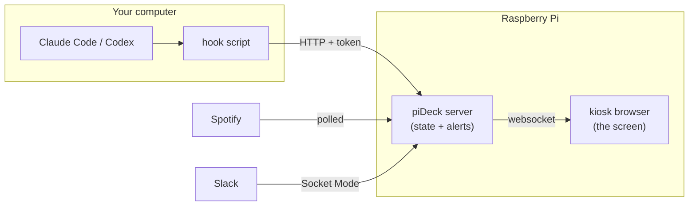

<h1 align="center">
  
</h1>

<p align="center"><b>A Raspberry Pi desk display:</b> Claude Code and Codex agent status, Spotify now-playing, and Slack notifications in one app. Swipe between pages; important events take over the whole screen.</p>

<p align="center">
  <a href="https://github.com/zapulam/piDeck/actions/workflows/ci.yml"></a>
  <a href="LICENSE"></a>
  
  
  
  
  
  
</p>

<p align="center">
  <br>
   <br>
  <sub>screenshots are an 800×480 display running <code>--mock</code> data. Album art is the property of its owners and is shown for illustration only.</sub>
</p>

## How it works



- **On your computer:** nothing stays running. You run one install command once; after that Claude Code or Codex starts a small hook script (Python, standard library only) on each event, and it posts the event to the Pi and exits.
- **On the Pi:** the piDeck server and a full-screen browser. Spotify and Slack are connected from the Pi, so those credentials never touch your computer.

Every source just tells the hub "state changed" or "raise an alert"; the UI is a single static page (no build step, works offline). Adding a new page = one source module + one renderer in `pideck/ui/app.js`.

## Try it now (no accounts needed)

```bash
python3 -m venv .venv && . .venv/bin/activate
pip install -r requirements.txt
python -m pideck --mock          # open http://localhost:8765  (use arrow keys or swipe)
```

## Integrations

- **Claude Code** — one tile per session: working, needs you, done, idle, with a context-used bar and full-screen alerts. Connects through Claude Code hooks. [Setup](#claude-code-and-codex)
- **Codex CLI** — the same tiles, without the context bar. Connects through Codex hooks, or the older `notify` setting (done-only). [Setup](#claude-code-and-codex)
- **Spotify** — now playing with album art and progress, plus play/pause/next/previous (controls need Premium). Connects through the Spotify Web API. [Setup](#spotify)
- **Slack** — DMs and @mentions to your bot, plus any channels you pick, with alerts. Connects through Socket Mode, so no public URL is needed. [Setup](#slack)

Each one can be switched off under `modules:` in `config.yaml`, and the pages you see are listed under `views:`. Spotify, Slack and Codex are covered by automated tests with simulated data; they haven't been run against live accounts yet, so expect to tune a little on first use. Want another source? A new integration is one module in `pideck/sources/` plus one page renderer in `pideck/ui/app.js`.

## Setup

### 1. On the Raspberry Pi: the server and the screen

```bash
git clone https://github.com/zapulam/piDeck ~/piDeck && cd ~/piDeck
python3 -m venv .venv && .venv/bin/pip install -r requirements.txt
sudo cp deploy/pideck.service /etc/systemd/system/ && sudo systemctl enable --now pideck
```

Edit `User=` and the paths in the service file if yours differ. Then start `deploy/kiosk.sh` from your desktop session's autostart (on Raspberry Pi OS with labwc: add `/home/pi/piDeck/deploy/kiosk.sh` to `~/.config/labwc/autostart`). The kiosk must open `http://localhost:8765`: the Pi's own browser is trusted without a token only on that address.

On first start the server creates an access token, saves it as `PIDECK_TOKEN` in `.env`, and prints the exact command to run on your computer. Run `python -m pideck` once in a terminal to see it, or find the token in `.env`.

For Spotify and Slack, copy the credentials from `.env.example` into `.env` (see their sections below) and set `mock: false` in `config.yaml`.

**Portrait, landscape, or rotated.** The layout follows the screen's shape on its own: portrait (720×1280), landscape (1280×720, 800×480), and square all work. The Raspberry Pi Touch Display 2 is natively portrait, so to use it sideways either rotate it in the OS (recommended: Screen Configuration on Raspberry Pi OS, or `wlr-randr --output DSI-1 --transform 90`; touch rotates with it), or set `ui.rotate: 90` (or 180 / 270) in `config.yaml`. Try it live with `http://localhost:8765/?rotate=90`.

### Claude Code and Codex

On each computer that runs Claude Code or Codex you need Python 3 and a copy of this repo (or just its `hooks/` folder). Run once:

```bash
python3 hooks/install.py --url http://YOUR-PI:8765 --token YOUR_PIDECK_TOKEN --test
```

It checks the server is reachable, saves the address and token, copies the hook script next to them (so the repo can be deleted afterwards), adds the hooks to Claude Code and/or Codex (whichever it finds), and shows a test tile on the display. It leaves your other settings alone, keeps a backup of anything it edits, and can be re-run safely. `--dry-run` shows what it would do; `--uninstall` removes everything. Restart any open sessions afterwards.

It works the same for the terminal and for desktop or editor apps, because the address is saved in a file rather than an environment variable (apps launched from a dock or Start menu don't see shell exports).

<details>
<summary>Prefer to do it by hand?</summary>

Merge `hooks/settings.example.json` into `~/.claude/settings.json` (and `hooks/codex-hooks.example.json` into `~/.codex/hooks.json`), fixing the script path, and put your address in `~/.config/pideck/hook.json` as `{"url": "http://YOUR-PI:8765", "token": "..."}`, or export `PIDECK_URL` and `PIDECK_TOKEN`.
</details>

**What the tiles show.** Each session becomes a tile with its own pixel fruit, picked from the project name (piDeck is always the raspberry). **Working**: a shine sweeps across it. **Needs you**: a blinking "!" and a full-screen alert. **Done**: asleep, plus an alert. **Idle**: awake, glancing around. **Error**: dull colours and a sweat drop. The bar along the bottom is context used.

Notes: the tile name is the project folder (override with `PIDECK_NAME`). Context % is estimated from the session transcript's latest token usage against `PIDECK_CONTEXT_WINDOW` (default 200000; set 1000000 for 1M-context models). It's an estimate, not an official number. Drop `PostToolUse` from the hooks if you don't want a process spawned per tool call; the only downside is a tile staying "needs you" until the next prompt or stop.

**Codex specifics.** Codex has lifecycle hooks with the same shape as Claude Code's, so the same script works (the installer passes `--source codex`).

1. Codex hooks may be behind a feature flag on your version. If nothing shows up, add this to `~/.codex/config.toml`:
   ```toml
   [features]
   codex_hooks = true
   ```
2. No hooks? The older `notify` setting also works: `notify = ["python3", "/path/to/piDeck/hooks/pideck_hook.py"]` in `~/.codex/config.toml`. It only reports "turn finished", so you get done tiles and alerts but no working or needs-you states.

Differences from Claude Code: Codex has no session-end event, so a finished tile stays until it goes stale (`stale_hours`) or you clear it; there is no context-% bar, because Codex transcripts have a different format; and the needs-you state only appears if your Codex version emits a `PermissionRequest` hook event. This is based on Codex's public docs and write-ups, not on a live Codex session, so check it against your version.

### Spotify

1. Create an app at <https://developer.spotify.com/dashboard>, add redirect URI `http://127.0.0.1:8888/callback`.
2. Put `SPOTIFY_CLIENT_ID` / `SPOTIFY_CLIENT_SECRET` in `.env`, run `python -m pideck.spotify_auth`, paste the printed `SPOTIFY_REFRESH_TOKEN` into `.env`.
3. Now-playing works on any account; the on-screen play/pause/next/previous buttons need **Premium**.

### Slack

Create an app at <https://api.slack.com/apps> and:
- turn on **Socket Mode**, create an app-level token with `connections:write` → `SLACK_APP_TOKEN` (`xapp-…`)
- bot scopes: `users:read`, `im:history`, `app_mentions:read`, `channels:read` (+ `channels:history` for watched channels)
- event subscriptions (bot): `message.im`, `app_mention` (+ `message.channels`)
- install to your workspace → `SLACK_BOT_TOKEN` (`xoxb-…`)

You get DMs to the bot and @mentions of it in channels it's invited to. To watch extra channels, list their IDs under `modules.slack.channels`. Your own DMs with other people are not visible to a bot app. (Your workspace may require admin approval to install the app.)

## Development

```bash
pip install -r requirements-dev.txt
pytest
```

## Security

piDeck shows private things (Slack messages, what you are listening to, project names), so it is closed by default:

- **Only the Pi itself is trusted without a token.** The kiosk browser on `http://localhost:8765` just works. Everything else (the websocket, agent events, Spotify and Slack controls) needs the access token, which is created on first start and kept in `.env` (owner-only). Another device's browser can open `http://YOUR-PI:8765/?token=...` once; the token is remembered in that browser and removed from the address bar.
- **Cross-site and rebinding protection.** Requests and websockets from another web origin are refused, and "this machine" must be reached as `localhost`, so a web page you visit can't read your display or press its buttons.
- **Limits.** Event fields have length caps, and at most 100 sessions and 16 screens are kept.
- **Your replies stay on your computer by default.** The hook sends project names, states and short system notifications, not what the assistant said. To also show a 200-character snippet of the last reply on "done" alerts, set `PIDECK_SEND_MESSAGES=1` or `"send_messages": true` in `~/.config/pideck/hook.json`.
- **Sandboxed service.** `deploy/pideck.service` drops privileges and restricts the filesystem and network families. CI runs `pip-audit`, and Dependabot proposes updates.

What it does not do: encrypt traffic. The hook talks plain HTTP, so on a network you don't trust, put the Pi and your computer on a private tunnel such as [Tailscale](https://tailscale.com) or WireGuard (or put an HTTPS reverse proxy in front), and use the tunnel address as `--url`. For local-only use, set `server.host: 127.0.0.1`. See [SECURITY.md](SECURITY.md) to report a problem.
