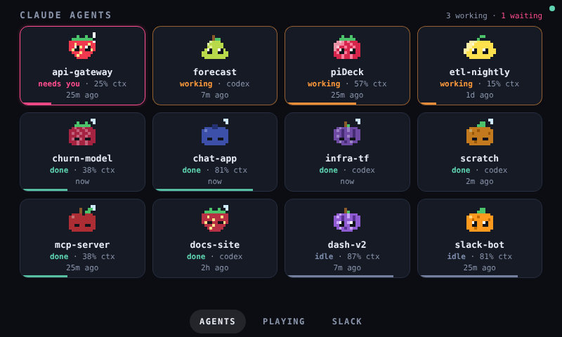
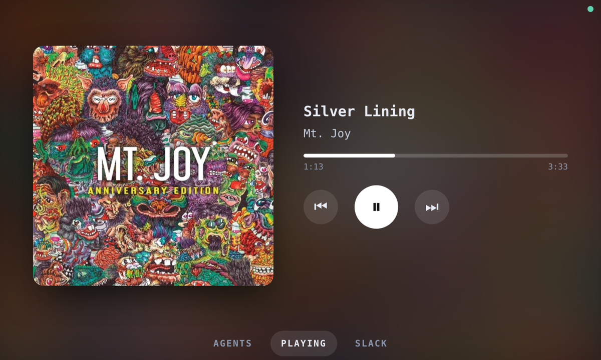
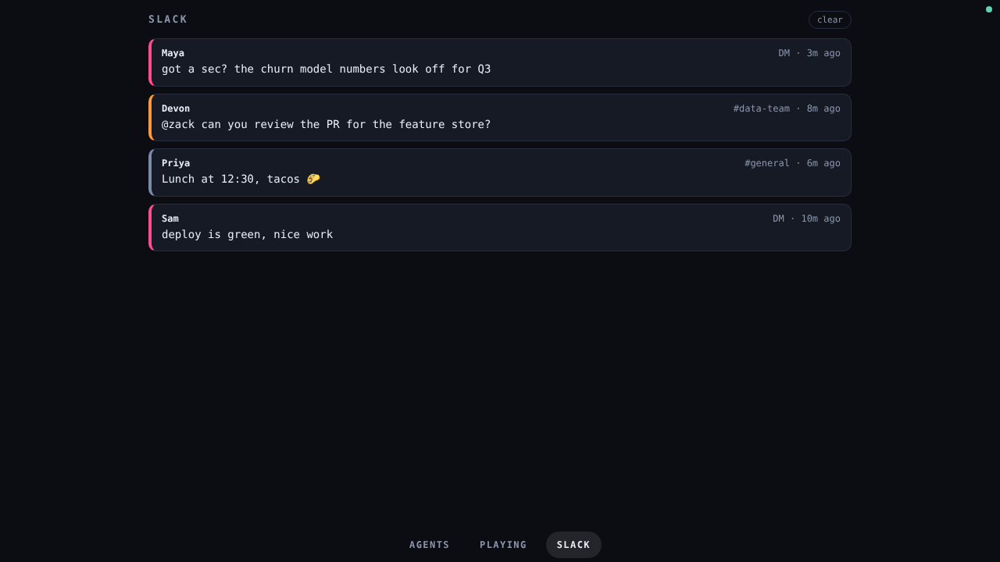

<h1 align="center">
  
</h1>

<p align="center"><b>A Raspberry Pi desk display:</b> Claude Code and Codex agent status, Spotify now-playing, and Slack notifications in one app. Swipe between pages; important events take over the whole screen.</p>

<p align="center">
  <a href="https://github.com/zapulam/piDeck/actions/workflows/ci.yml"></a>
  <a href="LICENSE"></a>
  
  
  
  
  
  
</p>

<p align="center">
  <br>
   <br>
  <sub>screenshots are an 800×480 display running <code>--mock</code> data. Album art is the property of its owners and is shown for illustration only.</sub>
</p>

## How it works

```
Claude Code / Codex hooks ──POST──┐
Spotify Web API ──poll────┼─▶ pideck server (FastAPI) ──websocket──▶ browser UI (kiosk on the Pi)
Slack Socket Mode ──push──┘        hub = state + alerts
```

Every source just tells the hub "state changed" or "raise an alert"; the UI is a single static page (no build step, works offline). Adding a new page = one source module + one renderer in `pideck/ui/app.js`.

## Try it now (no accounts needed)

```bash
python3 -m venv .venv && . .venv/bin/activate
pip install -r requirements.txt
python -m pideck --mock          # open http://localhost:8765  (use arrow keys or swipe)
```

## Integrations

What piDeck can show today:

| Integration | What it shows | Status | How it connects |
|---|---|---|---|
| **Claude Code** | One tile per session: working, needs you, done, idle, plus a context-used bar and full-screen alerts | Supported | Claude Code hooks post to the server |
| **Codex CLI** | The same tiles; no context bar | Supported | Codex hooks, or the older `notify` setting (done-only) |
| **Spotify** | Now playing with album art, progress, and play/pause/next/previous | Supported (controls need Premium) | Spotify Web API, polled |
| **Slack** | DMs and @mentions to your bot, plus any channels you pick, with alerts | Supported | Socket Mode (no public URL needed) |
| **ChatGPT** (web and phone apps) | n/a | Not possible | No hooks or API report what it is doing |

Each one can be switched off under `modules:` in `config.yaml`, and the pages you see are listed under `views:`. Spotify, Slack and Codex are covered by automated tests with simulated data; they haven't been run against live accounts yet, so expect to tune a little on first use. Want another source? A new integration is one module in `pideck/sources/` plus one page renderer in `pideck/ui/app.js`.

To get started, copy `.env.example` to `.env`, set `mock: false` in `config.yaml`, then follow the section for each integration:

### Claude Code agents
1. Optional but recommended: set `PIDECK_TOKEN` in `.env` (any random string).
2. On each machine that runs Claude Code, merge `hooks/settings.example.json` into `~/.claude/settings.json` (fix the script path), and export `PIDECK_URL` (e.g. `http://pideck.local:8765`) and `PIDECK_TOKEN`.
3. Each session becomes a tile with its own pixel fruit, picked from the project name (piDeck is always the raspberry). **Working**: a shine sweeps across it. **Needs you**: a blinking "!" and a full-screen alert. **Done**: asleep, plus an alert. **Idle**: awake, glancing around. **Error**: dull colours and a sweat drop. The bar along the bottom is context used.

Notes: the tile name is the project folder (override with `PIDECK_NAME`). Context % is estimated from the session transcript's latest token usage against `PIDECK_CONTEXT_WINDOW` (default 200000; set 1000000 for 1M-context models). It's an estimate, not an official number. Drop `PostToolUse` from the hooks if you don't want a process spawned per tool call; the only downside is a tile staying "needs you" until the next prompt or stop.

### Codex agents (OpenAI Codex CLI)

Codex has lifecycle hooks with the same shape as Claude Code's, so the same script works; just tell it the source with `--source codex`.

1. Merge `hooks/codex-hooks.example.json` into `~/.codex/hooks.json` (fix the script path), and export `PIDECK_URL` / `PIDECK_TOKEN` where you run Codex.
2. Codex hooks may be behind a feature flag on your version. If nothing shows up, add this to `~/.codex/config.toml`:
   ```toml
   [features]
   codex_hooks = true
   ```
3. No hooks? The older `notify` setting also works: `notify = ["python3", "/path/to/piDeck/hooks/pideck_hook.py"]` in `~/.codex/config.toml`. It only reports "turn finished", so you get done tiles and alerts but no working or needs-you states.

Differences from Claude Code: Codex has no session-end event, so a finished tile stays until it goes stale (`stale_hours`) or you clear it; there is no context-% bar, because Codex transcripts have a different format; and the needs-you state only appears if your Codex version emits a `PermissionRequest` hook event. This is based on Codex's public docs and write-ups, not on a live Codex session, so check it against your version.

**ChatGPT** (the web and phone apps) can't be supported: it has no hooks or API that report what it is doing. Codex is the OpenAI side that can.

### Spotify
1. Create an app at <https://developer.spotify.com/dashboard>, add redirect URI `http://127.0.0.1:8888/callback`.
2. Put `SPOTIFY_CLIENT_ID` / `SPOTIFY_CLIENT_SECRET` in `.env`, run `python -m pideck.spotify_auth`, paste the printed `SPOTIFY_REFRESH_TOKEN` into `.env`.
3. Now-playing works on any account; the on-screen play/pause/next/previous buttons need **Premium**.

### Slack
Create an app at <https://api.slack.com/apps> and:
- turn on **Socket Mode**, create an app-level token with `connections:write` → `SLACK_APP_TOKEN` (`xapp-…`)
- bot scopes: `users:read`, `im:history`, `app_mentions:read`, `channels:read` (+ `channels:history` for watched channels)
- event subscriptions (bot): `message.im`, `app_mention` (+ `message.channels`)
- install to your workspace → `SLACK_BOT_TOKEN` (`xoxb-…`)

You get DMs to the bot and @mentions of it in channels it's invited to. To watch extra channels, list their IDs under `modules.slack.channels`. Your own DMs with other people are not visible to a bot app. (Your workspace may require admin approval to install the app.)

## On the Pi

```bash
git clone https://github.com/zapulam/piDeck ~/piDeck && cd ~/piDeck
python3 -m venv .venv && .venv/bin/pip install -r requirements.txt
sudo cp deploy/pideck.service /etc/systemd/system/ && sudo systemctl enable --now pideck
```
Then start `deploy/kiosk.sh` from your desktop session's autostart (on Raspberry Pi OS with labwc: add `/home/pi/piDeck/deploy/kiosk.sh` to `~/.config/labwc/autostart`). Edit `User=`/paths in the service file if yours differ.

### Portrait, landscape, or rotated

The layout follows the screen's shape on its own: portrait (720×1280), landscape (1280×720, 800×480), and square all work. The Raspberry Pi Touch Display 2 is natively portrait, so to use it sideways either:
- **rotate it in the OS** (recommended): Screen Configuration on Raspberry Pi OS, or `wlr-randr --output DSI-1 --transform 90`; the touch input rotates with it, or
- **rotate it in piDeck**: set `ui.rotate: 90` (or 180 / 270) in `config.yaml`. You can try it live with `http://localhost:8765/?rotate=90`.

Pages are listed in `views:` in `config.yaml`.

## Development

```bash
pip install -r requirements-dev.txt
pytest
```

## Security

The server has no login. Anything on your network can open the display and use the Spotify buttons; the agent endpoint is protected by `PIDECK_TOKEN` when set. Keep it on a trusted LAN, or set `server.host: 127.0.0.1` if you only use it locally.
